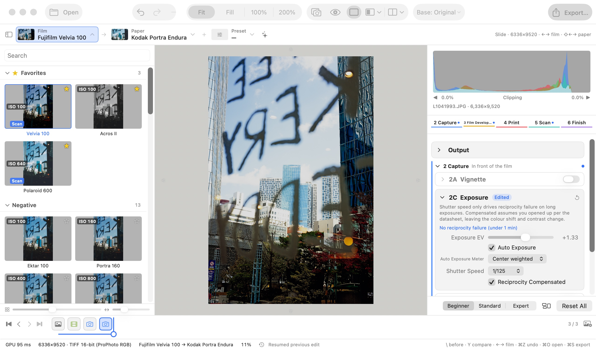
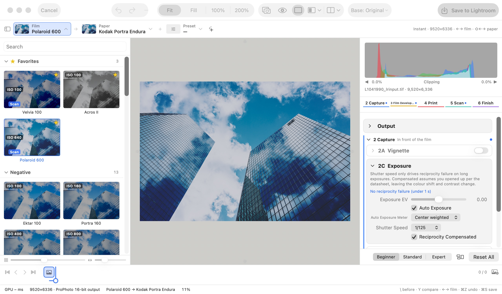

# PhotoEmul

A native macOS film emulation editor built on [spektrafilm](https://github.com/andreavolpato/spektrafilm), with a round trip to Lightroom Classic.

[한국어](README.ko.md)



PhotoEmul models the whole analogue chain: film stock, exposure and reciprocity, development and storage, enlarger light and filters, printing paper, grain, halation and lens. Every change shows in a live preview, rendered on the GPU.

PhotoEmul is not made by, affiliated with, or supported by the spektrafilm or spektrafilm-ofx authors, or by Adobe.

- macOS 14 or later, Apple silicon or Intel
- UI in English and Korean
- No analytics. No network access unless you turn on an AI add-in in the AI tab

## What it does

- Film and paper stocks from spektrafilm (colour negative, slide, cine, black and white, instant), plus derived stocks
- Capture: exposure, shutter time with reciprocity failure, scene light (daylight, tungsten, fluorescent, LED, sodium and others)
- Development and storage: temperature, time, developer, ageing and humidity, uneven development, bromide drag
- Darkroom: enlarger light and Y/M/C filters, print exposure, test strips
- Grain, halation, diffusion, dust and scratches, lens profiles (lensfun)
- History timeline, snapshots, presets, side-by-side and split compare
- Lightroom Classic plug-in: send photos, edit, and get a 16-bit TIFF stacked on the original
- Export JPEG or 16-bit TIFF, or a 3D LUT
- Optional AI tab: describe a look and review the model's proposed edits step by step (Claude API, OpenAI-compatible servers, local models, or Claude Code through the built-in MCP server `PhotoEmul --mcp`)

## Install

### Download

Each release has two files: `PhotoEmul-<version>.zip` (the app, Apple silicon and Intel) and `PhotoEmul-Lightroom-<version>.zip` (the Lightroom Classic plug-in).

Downloaded builds are signed ad hoc and not notarized, so macOS refuses to open them the first time:

1. Unzip, move PhotoEmul to Applications, and open it. macOS says it was "Not Opened": click **Done** (not Move to Trash).
2. Open System Settings › Privacy & Security, scroll down, and click **Open Anyway**.

Or, in Terminal: `xattr -dr com.apple.quarantine /Applications/PhotoEmul.app`

### Build yourself

You need Xcode command line tools (`xcode-select --install`), CMake and Python 3.

```sh
git clone --recursive https://github.com/yandyne/PhotoEmul.git
cd PhotoEmul
# Python packages the engine build uses to generate its data tables
python3 -m venv .venv && .venv/bin/pip install numpy scipy colour-science
# the engine (C++/Metal, spektrafilm-ofx) as a universal static library, once
cmake -S build/ofx/SpektraFilm -B build/ofx/SpektraFilm/build-universal -DPython3_EXECUTABLE="$PWD/.venv/bin/python" \
  -DCMAKE_BUILD_TYPE=Release -DCMAKE_OSX_ARCHITECTURES="arm64;x86_64" -DCMAKE_OSX_DEPLOYMENT_TARGET=11.0
app/build.sh                    # writes app/build/PhotoEmul.app (universal); rebuilds the engine when needed
ARCHS=arm64 app/build.sh        # Apple silicon only, faster
app/build/PhotoEmul.app/Contents/MacOS/PhotoEmul --self-test   # exit code 0 when all checks pass
```

The engine is a git submodule: [yandyne/spektrafilm-ofx](https://github.com/yandyne/spektrafilm-ofx), branch `photoemul`, which is [chaert-s/spektrafilm-ofx](https://github.com/chaert-s/spektrafilm-ofx) with PhotoEmul's changes on top.

## Lightroom Classic

1. Install the plug-in:
   - From a download: unzip `PhotoEmul-Lightroom-<version>.zip`, then in Lightroom Classic File › Plug-in Manager… › Add, and pick `PhotoEmul.lrplugin`. It looks for the app at `/Applications/PhotoEmul.app`.
   - From source: `lightroom/install.sh` copies the plug-in into Lightroom's Modules folder and points it at `app/build/PhotoEmul.app` (`--uninstall` removes it).
2. Restart Lightroom. The app path can be changed in File › Plug-in Manager › PhotoEmul.
3. Pick photos, then File › Plug-in Extras (or Library › Plug-in Extras):
   - **Edit in PhotoEmul (with Lightroom Adjustments)**: a 16-bit ProPhoto TIFF with your current Develop settings. Set exposure and white balance in Lightroom, the film look in PhotoEmul.
   - **Edit in PhotoEmul (Original Raw)**: opens the raw file as is; Lightroom adjustments are ignored.
4. With several photos, choose **Same Edit for All** or **One by One**.
5. Adjust, then **Save to Lightroom**. The result, `<name>-photoemul.tif`, is written beside the original and stacked on it.



Closing without saving adds nothing. Edits and snapshots are kept per photo, so opening the same photo again continues where you left off.

The plug-in follows Lightroom's language: English, or Korean when Lightroom runs in Korean. Lightroom (the cloud version) does not support plug-ins.
Logs: `~/Library/Logs/Adobe/Lightroom/LrClassicLogs/PhotoEmul.log`.

PhotoEmul also works on its own: open a file or drop it on the window, and export with File › Export.

## Creative profiles (bonus)

`tools/sf4lr` bakes film looks into LUT-based XMP profiles for the Lightroom / Camera Raw profile browser (no grain, halation or parameters). Ready-made ones are in `build/profiles/spektrafilm`. To bake them yourself you need spektrafilm installed in a Python virtual environment (`.venv`):

```sh
cd tools && ../.venv/bin/python -m sf4lr.bake --out ../build/profiles/spektrafilm
cp -R ../build/profiles/spektrafilm/. ~/Library/Application\ Support/Adobe/CameraRaw/Settings/spektrafilm/
```

## Your data

- Settings: the app's preferences (`com.yandyne.PhotoEmul`)
- Presets, sessions and the AI add-in socket: `~/Library/Application Support/PhotoEmul/`
- AI API keys: the macOS Keychain only
- Slider timing log: `~/Library/Logs/PhotoEmul/slider.log`

## Source layout

| Path | What it is |
|---|---|
| `app/Sources` | the app (SwiftUI, Metal) |
| `app/Shaders` | app-side effects (lens, dust, uneven development) |
| `app/build.sh` | build script |
| `build/ofx/SpektraFilm` | the film engine (C++/Metal, submodule) |
| `lightroom/` | Lightroom Classic plug-in (Lua) and installer |
| `tools/sf4lr` | creative profile baker (Python) |
| `tools/datasheets` | datasheet digitising and fitting scripts for derived stocks |

## How this was built

PhotoEmul was built by one person working with AI models (Claude Code) over 17 working days between 21 October and 22 November 2026.
The models wrote the code. The author decided what to build, tested every change, and sent it back when it was wrong.

| | The author | The models |
|---|---|---|
| Did | design, decisions, testing | code, tests, documents |
| Volume | 526 messages, 13 photos and screenshots | 14,286 responses, 7,456 commands and file operations |
| Time | about 36 hours | about 46 hours |

What the author's 526 messages were:

| Kind | Messages | Share |
|---|---|---|
| Questions and requests for proposals | 136 | 26% |
| Housekeeping | 123 | 23% |
| Test results and bug reports | 113 | 21% |
| Decisions | 82 | 16% |
| Requirements and design | 72 | 14% |

| Model | Working time | Responses |
|---|---|---|
| Claude Opus 5.5 | 35.2 h | 11,923 |
| Claude Fable 5.1 | 10.1 h | 2,218 |
| Claude Fable 5.2 | 0.5 h | 145 |

<sub>Counted from the session logs up to 22 Nov 2026. A model response is one logged assistant event (a reply is often several). Times are estimates: for the models, gaps of up to 5 minutes between events; for the author, the time from the model's last event to the next message, when 30 minutes or less. Kinds were assigned by reading each message; some fit more than one.</sub>

## Contributing

This is a personal project. Pull requests are not accepted and issues are turned off.
You are welcome to fork it and change it yourself under the license below.

## License and credits

PhotoEmul is free software under the GNU General Public License v3.0 or later, see [LICENSE](LICENSE).

- Film modeling powered by [spektrafilm](https://github.com/andreavolpato/spektrafilm) (Andrea Volpato, GPL-3.0). Please cite its repository / Zenodo DOI in academic work.
- GPU engine from [spektrafilm-ofx](https://github.com/chaert-s/spektrafilm-ofx) (Aedan Diez, GPL-3.0).
- Film, paper and filter profiles: CC BY-SA 4.0 (spektrafilm). Derived profiles carry a derivation note and are shared under the same license.
- Lens profiles converted from the [lensfun](https://lensfun.github.io) database: CC BY-SA 3.0.
- Dust and scratch statistics from [FilmDamageSimulator](https://github.com/daniela997/FilmDamageSimulator) (MIT).

The full list, with every license text, is in [app/Credits.html](app/Credits.html) (the app's About window).
"Lightroom" is Adobe's trademark, used here only to say what the plug-in works with.
